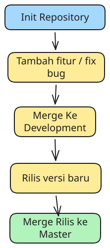

<div class="flex justify-center [&_img]:border [&_img]:border-black">



</div>

Git worklflow yang biasa saya gunakan ketika mengembangkan project terdiri dari:

1. Init repository.
2. Tambah fitur / fix bug.
3. Push ke development.
4. Semua fitur dan bugfix dikumpulkan di development.
5. Rilis versi baru.
6. Push release ke master.
7. Buat tag untuk versi baru.

Secara umum ada beberapa branch yang digunakan:

1. master / main
2. development
3. release/x.x.x
4. feat/x
5. fix/x

## 1. Init Repository

Pertama buat direktori project, misal nama projectnya blog.

```php
mkdir blog
cd blog
```

Kemudian init repository di project tersebut.

```bash
git init
```

Buat remote repository di github atau tempat lainnya, kemudian salin url reponya.

Tambahkan repository remote sebagai origin di repository local.

```bash
git remote add origin <url>
```

Untuk mengetest, buat file `README.md`, lalu coba push ke repository remote.

```bash
echo '# Blog' > README.md
git add .
git commit -m "Create README.md"
git push origin master
```

## 2. Membuat Branch Development

Branch development adalah branch untuk mengumpulkan fitur-fitur dan bug fix yang sudah selesai tapi belum ingin direlease.

Pertama kali, buat branch development dengan sumber dari branch master.

```php
git switch -c development master
git push origin development
```

## 3. Tambah Fitur / Fix Bug

Ketika hendak menambahkan fitur buat branch baru dari branch development.

```bash
git switch -c feat/x development
```

Begitu juga ketika hendak fixing bug.

```bash
git switch -c fix/x development
```

Lakukan coding, lalu commit dan push remote repository.

```bash
git add .
git commit -m "feat: add x feature"
git push origin feat/x
# atau
git add .
git commit -m "fix: fix x bug"
git push origin fix/x
```

## 4. Merge Request Fitur/Fix Ke Development

Setelah fitur terbuat atau fix terbenahi, lakukan merge request ke branch development.

Merge request biasanya dilakukan lewat UI di remote remository.

Jangan lupa hapus branch yang sudah dimerge ke development agar tidak menjadi sampah.

## 5. Release

Kumpulkan semua fitur dan fix bug di branch development sampai siap untuk rilis versi baru.

Terkadang satu fitur atau satu fix bug juga bisa untuk rilis versi baru.

Untuk merilis versi baru, buat branch baru dengan nama release/x.x.x yang bersumber dari branch development.

```bash
git switch -c release/x.x.x development
```

### Update Changelog

Setiap hendak rilis versi baru, hendaknya dicatat perubahan pada versi tersebut di file `CHANGELOG.md`.

Format dan spesifikasinya biasanya seperti berikut:

```php
# Changelog

## [<versi>] - <tanggal>

### Added

- <fitur 1> (#<no merge request fitur 1>)
- <fitur 2> (#<no merge request fitur 2>)
- <fitur 3> (#<no merge request fitur 3>)

### Fixed

- <bugfix 1> (#<no merge request bugfix 1>)
- <bugfix 2> (#<no merge request bugfix 2>)
- <bugfix 3> (#<no merge request bugfix 3>)
```

Contoh

```php
# Changelog

## [1.1.0] - 2026-09-01

### Added

- Set current user (#2)

### Fixed

- Pass query on redirects to unauthenticated path (#1)
```

Commit perubahan setelah `CHANGELOG` diperbarui.

```php
git add CHANGELOG.md
git commit -m "Update CHANGELOG.md"
```

### Perbarui Versi NPM

Jika project menggunakan NPM, buat versi baru dengan command `npm version <jenis-update>`.

Jenis update bisa `major`, `minor` dan `patch`.

```php
# sebelum v1.2.0
npm version major # jadi v2.0.0

# sebelum v1.2.0
npm version minor # jadi v1.3.0

# sebelum v1.2.4
npm version patch # jadi v1.2.5
```

Perintah `npm version` juga akan membuat tag baru untuk versi baru yang dibuat.

```php
# 1.4.1
npm version major

git tag -l
# 1.4.0
```

Perintah `npm version` juga akan membuat commit untuk versi baru.

## 6. Merge Request Release ke Master

Setelah branch release dibuat, push branch beserta tagnya ke remote repository dan lakukan merge request ke master.

```php
git push origin release/x.x.x --tags
```

## Selesai

Itulah git workflow sederhana yang biasa saya lakukan dalam suatu project. Ada beberapa yang belum dijelaskan seperti:

1. Hot fix bug.
2. Testing.
3. CI/CD
4. dsb.

Semua itu akan dijelaskan di artikel selanjutnya.
